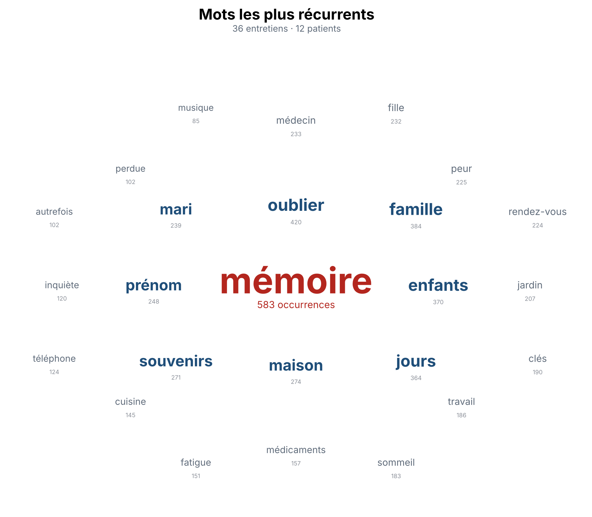

# Analyse des mots récurrents dans des entretiens

Lit un dossier d'entretiens, range les fréquences de mots dans une base de données
SQLite, et dessine pour tout le corpus et pour chaque patient un diagramme : le mot
le plus récurrent au centre, les suivants autour.



*(Exemple produit à partir d'entretiens inventés pour le test.)*

## Installation (une seule fois)

1. Installer Python depuis <https://www.python.org/downloads/> (sous Windows, cocher
   « Add Python to PATH » pendant l'installation).
2. Dans un terminal :

```bash
pip install matplotlib python-docx pypdf
```

## Utilisation

```bash
python analyse.py "C:\chemin\vers\mes_entretiens"
```

Formats lus : `.txt`, `.docx`, `.pdf` (PDF avec texte, pas les scans), sous-dossiers compris.

**Identification du patient**

- un sous-dossier par patient : le nom du sous-dossier est l'identifiant ;
- tous les fichiers au même endroit : le début du nom de fichier jusqu'au premier `_`
  (`P001_entretien2.docx` → patient `P001`).

## Résultats

Tout est écrit dans le dossier `resultats/` :

| Fichier | Contenu |
|---|---|
| `diagrammes/_corpus.png` | diagramme pour l'ensemble des entretiens |
| `diagrammes/<patient>.png` | un diagramme par patient |
| `frequences_corpus.csv` | tous les mots, classés (s'ouvre dans Excel) |
| `frequences_par_patient.csv` | les 25 premiers mots de chaque patient |
| `entretiens.db` | la base SQLite (tables `entretiens` et `frequences`) |

## Réglages

- **Mots à ignorer** : ouvrir `mots_vides.txt`, ajouter les mots sans intérêt qui
  remontent dans les diagrammes, relancer.
- **Répliques de l'intervieweur** : si chaque réplique commence par un libellé, les exclure avec

```bash
python analyse.py mes_entretiens --ignorer-lignes "Intervieweur :" "Q :"
```

- `--top 15` : moins de mots par diagramme (25 au maximum).
- `--sans-diagrammes-patients` : uniquement le diagramme global.
- `--sortie autre_dossier` : changer le dossier de résultats.

## Limites

- Les formes d'un même mot sont comptées séparément (« oublie », « oublié », « oublier »).
- Seules les lignes commençant par le libellé indiqué sont exclues : une réplique
  d'intervieweur qui s'étend sur plusieurs lignes n'est retirée qu'à sa première ligne.

## Confidentialité

Les entretiens et les résultats restent sur votre ordinateur : le script n'envoie rien
en ligne. Ne déposez pas les entretiens ni le dossier `resultats/` dans ce dépôt
(le `.gitignore` les exclut par défaut).
